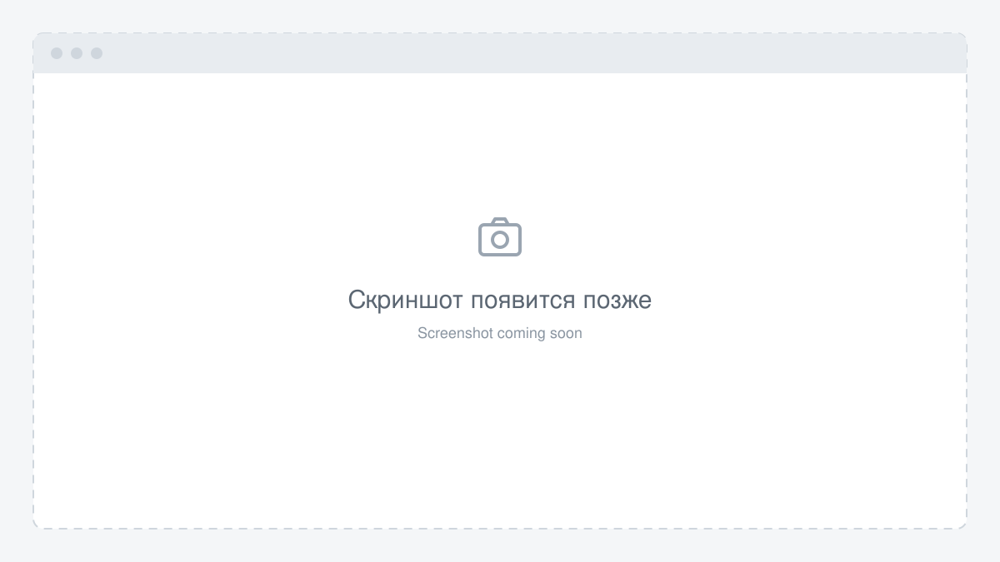

# MedScribe от MagaMED

Голосовой помощник врача: запись приёма → стенограмма → черновик протокола.

**Установить на свой компьютер:** [Windows](docs/install/WINDOWS.md) · [macOS](docs/install/MACOS.md) · [Linux](docs/install/LINUX.md)

[Что понадобится](docs/START.md) · [Подключить ИИ](docs/CONNECT_AI.md) · [Первая пробная запись](docs/FIRST_PROTOCOL.md) · [Если возникла ошибка](docs/HELP.md)

Ниже — описание проекта и подробности для разработчиков.

<details>
<summary>English overview and quick start</summary>

**What is it.** MedScribe is a self-hosted voice assistant for a single physician (Russian-language). It listens to a consultation (the doctor's microphone; for online visits, browser-tab audio mixed with the doctor's microphone), transcribes it locally with [T-one](https://github.com/voicekit-team/T-one), de-identifies the text, sends it to any OpenAI-compatible LLM and returns a draft protocol whose quotes are checked against the transcript. The physician always reviews the result. The database stays on your machine; the visit text goes to the LLM you configure. Not a medical device, see [DISCLAIMER.md](DISCLAIMER.md).

**Quick start.** Install and start [Docker Desktop](https://www.docker.com/products/docker-desktop/), then run one line in a terminal. It downloads ready-made images (nothing is built on your machine), starts everything and opens your browser:

```bash
# macOS / Linux
curl -fsSL https://raw.githubusercontent.com/Allmostkill/medscribe/main/scripts/install.sh | sh
```

```powershell
# Windows (PowerShell). Windows support is new: please report problems.
[Net.ServicePointManager]::SecurityProtocol='Tls12'; iex ((irm https://raw.githubusercontent.com/Allmostkill/medscribe/main/scripts/install.ps1).TrimStart([char]0xFEFF))
```

Then register in the browser and connect a language model in Profile -> AI settings. A server with your own domain and HTTPS: see [Доступ с других компьютеров, HTTPS и микрофон](#доступ-с-других-компьютеров-https-и-микрофон). Manual install with `git clone` and Compose is described under [Ручная установка](#ручная-установка-для-разработчиков).

</details>

**Пошаговая инструкция на русском: [docs/GUIDE.md](docs/GUIDE.md)**

**License:** AGPL-3.0-or-later. Copyright (c) Magomed Ilyasov. The MagaMED name and logo are not covered by the AGPL, see [NOTICE](NOTICE). The rest of this document is in Russian.



---

## Для кого

Это открытая программа для частного использования одним врачом: скачали, запустили, данные лежат на вашем компьютере. Облачных баз и регистрации через сайт нет. В базе всегда один врач: второй аккаунт создать нельзя.

## Что это

MedScribe помогает врачу вести приём. Врач включает запись, система распознаёт речь, а языковая модель собирает из разговора черновик протокола и подсказывает, что могло быть упущено. Врач проверяет и правит протокол сам.

Путь данных:

```
микрофон врача (онлайн-приём: звук вкладки браузера + микрофон врача)
   -> T-one (распознавание речи, локально, tone-service/)
   -> деидентификация (src/server/deidentify.ts)
   -> LLM по OpenAI-совместимому API
   -> протокол; цитаты сверяются со стенограммой
```

Проект не является медицинским изделием и не заменяет решение врача. Перед использованием с реальными пациентами прочитайте [DISCLAIMER.md](DISCLAIMER.md). Устройство программы для разработчиков: [docs/ARCHITECTURE.md](docs/ARCHITECTURE.md).

## Что умеет

Всё перечисленное есть в коде (`src/server/routes`, `src/Dashboard.tsx`, `src/components`).

- Распознавание речи: живая стенограмма во время приёма (WebSocket `/ws/stt/tone`, `src/server/ws/toneProxy.ts`) и режим «стенографа» — запись целиком, затем распознавание сегментами по 20 минут (`/api/stt/full`). Режим стенографа работает только для очного приёма. Источник звука: микрофон врача (очный приём) или, для онлайн-приёма («Записать звонок»), звук вкладки браузера через `getDisplayMedia`, смешанный с микрофоном врача в один поток (`src/services/sttStream.ts`). После остановки живой записи приём в фоне перерасшифровывается по полной записи.
- Звук записи сохраняется в браузере примерно каждые 5 секунд, поэтому при закрытии вкладки или сбое теряются лишь последние секунды. Если живая расшифровка не удалась и текста нет, запись остаётся в IndexedDB браузера до 7 суток; на стартовом экране есть кнопка «Расшифровать».
- Стартовый экран показывает плашку состояния (нет связи с программой, не отвечает база, модель речи ещё загружается, языковая модель не подключена: `ServiceStatusBanner`, данные из `GET /api/health`) и «Проверить микрофон» (`MicCheck`).
- Протокол приёма по стенограмме (`/api/ai/analyze`) с учётом специальности врача, первичного или повторного приёма, личного шаблона протокола и контекста из МИС, который врач вставляет сам. Правки протокола сохраняются в историю автоматически. «Скопировать в МИС» и «В МИС» в истории копируют все восемь разделов (`src/utils/ehrText.ts`).
- Проверка записи (`/api/ai/note-check`): сверка протокола со стенограммой, в том числе пометка осмотра в дистанционном приёме, где его не было. Эта проверка срабатывает в режиме записи звука вкладки браузера.
- Подсказки по ходу приёма (`/api/ai/hints`), проверка лекарственных назначений (`/api/ai/pharma`), разбор общения врача с пациентом (`/api/ai/communication`, пункт без дословной цитаты из стенограммы отбрасывается), варианты кодов МКБ-10 из справочника (`/api/ai/suggest-diagnosis`).
- Памятка пациенту (`/api/ai/patient-summary`) из утверждённого врачом протокола.
- Понятные причины сбоев языковой модели (`llmErrorMessage` в `src/server/llm.ts`) показываются на экране. В личном кабинете (Профиль, вкладка «Настройки ИИ») есть карточка «Языковая модель»: подключение Ollama или облачной модели, «Проверить подключение» и «Отключить» (`src/components/LlmSettingsCard.tsx`, `GET /api/ai/llm-status`; сам ключ не отдаётся).
- Справочный блок: МКБ-10, клинические рекомендации Минздрава, фарм-справочник, клинические калькуляторы и дозы, шаблоны назначений. Чек-листы и свои виджеты. Раскладку рабочего поля врач настраивает и она сохраняется.
- Вход по паролю; двухфакторная аутентификация (TOTP) по желанию, по умолчанию выключена. «Выйти из системы» отзывает refresh-токен на сервере.
- Черновики протоколов хранятся в базе в зашифрованном виде.

Интерфейс и промпты русскоязычные.

## Что нужно

- Docker (на macOS и Windows это Docker Desktop) с Compose версии 2.24 или новее. Установщик проверяет версию сам.
- Языковая модель: локальная Ollama или ключ облачного сервиса. Подключается в самой программе (Профиль, «Настройки ИИ»). Без неё запись и стенограмма работают, а протокол и другие ИИ-функции — нет.
- Железо: от 16 ГБ ОЗУ (одна T-one занимает около 5 ГБ, Docker нужно отдать не меньше 8 ГБ), 4 vCPU, не меньше 15 ГБ свободного места (программа около 5 ГБ, модель речи 5,6 ГБ, запас). Загрузка при установке около 1,2 ГБ. GPU не нужен. В Docker Desktop выделите не меньше 8 ГБ памяти; установщик проверит это и подскажет, как исправить.
- Проверено на Apple Silicon (arm64) и на Linux. Windows поддерживается, но установщик для него новый: если что-то пошло не так, сообщите автору (репозиторий указан внизу).

## Быстрый старт

**Нет опыта с Docker? Пошаговая инструкция для врача с подсказками «что вы должны увидеть»: [docs/GUIDE.md](docs/GUIDE.md).**

1. Установите и запустите Docker Desktop: [macOS](https://docs.docker.com/desktop/setup/install/mac-install/), [Windows](https://docs.docker.com/desktop/setup/install/windows-install/), [Linux](https://docs.docker.com/desktop/setup/install/linux/). Дождитесь, пока он напишет, что работает.

2. Вставьте в терминал одну строку и нажмите Enter. Она скачивает готовые образы (ничего не собирается), запускает программу и сама открывает браузер. Выберите свою систему.

   macOS и Linux (программа «Терминал»):

   ```bash
   curl -fsSL https://raw.githubusercontent.com/Allmostkill/medscribe/main/scripts/install.sh | sh
   ```

   Windows (PowerShell, права администратора не нужны; установщик для Windows новый, сообщите, если что-то не так):

   ```powershell
   [Net.ServicePointManager]::SecurityProtocol='Tls12'; iex ((irm https://raw.githubusercontent.com/Allmostkill/medscribe/main/scripts/install.ps1).TrimStart([char]0xFEFF))
   ```

   Сервер с собственным доменом и HTTPS (только Linux; нужны домен и открытые порты 80 и 443):

   ```bash
   curl -fsSL https://raw.githubusercontent.com/Allmostkill/medscribe/main/scripts/install-server.sh | sh
   ```

   Браузер открывается сразу, как запустилась база данных. Модель распознавания речи (около 5,6 ГБ с HuggingFace) докачивается в фоне, обычно 15–20 минут: прогресс виден в терминале, а в программе до готовности висит жёлтая плашка о загрузке. Регистрироваться можно сразу, а записывать приём — когда модель загрузится. Ctrl+C в терминале безопасен: установка идёт в фоне. Если терминал закрыли, запустите ту же строку ещё раз: она покажет прогресс и ссылку. Данные при повторном запуске не удаляются.

   Установщик (кроме серверного режима) создаёт ярлык «MedScribe»; его делает `scripts/open.sh` (macOS, Linux) или `scripts/open.ps1` (Windows). Двойной щелчок поднимает остановленные контейнеры (без скачивания), ждёт готовности и открывает программу в браузере (до создания первой учётной записи сразу со страницей регистрации). На macOS и Windows ярлык при необходимости сам запускает Docker Desktop. На Linux он Docker не запускает: если Docker выключен, ярлык скажет, что сделать. Где лежит ярлык: macOS — `~/Applications/MedScribe.app` (виден в Launchpad и поиске Spotlight; на рабочий стол не пишем, чтобы система не запрашивала доступ; в конце установки Finder показывает его, перетащите в Dock), Windows — `MedScribe.lnk` на рабочем столе, Linux — `.desktop` в меню приложений и, если есть папка рабочего стола, на нём. Повторный запуск строки установки пересоздаёт ярлык (в Windows обновление делается этой строкой), а `scripts/update.sh` (macOS, Linux) только обновляет уже существующий: удалённый ярлык он не вернёт. Чужой файл с таким же именем установщик не трогает. Чтобы убрать ярлык, удалите `MedScribe.app` (macOS), `MedScribe.lnk` с рабочего стола (Windows) или `MedScribe.desktop` и `~/.local/share/applications/medscribe.desktop` (Linux). Значки лежат в `scripts/icons`, пересобрать их можно скриптом `scripts/icons/make-icons.sh` (macOS).

3. В браузере создайте аккаунт (ФИО, email, пароль не короче 8 символов, специальность), затем откройте «Профиль», вкладку «Настройки ИИ» и подключите языковую модель в карточке «Языковая модель»: «Ollama на этом компьютере» или «Облачная модель». Для облачной модели нужно поставить галочку «Я понимаю, что текст приёма уйдёт провайдеру»: при зарубежном провайдере это трансграничная передача данных о здоровье (152-ФЗ), см. раздел «Языковая модель».

Установщик понимает необязательные переменные окружения, которые ставят перед `sh` (macOS и Linux) или в PowerShell командой `$env:ИМЯ='значение'` перед строкой установки: `APP_PORT` (порт вместо 3000), `MEDSCRIBE_DIR` (папка вместо `~/medscribe`), `MEDSCRIBE_VERSION` (конкретная версия), `MEDSCRIBE_NO_BROWSER=1` (не открывать браузер), `MEDSCRIBE_NO_SHORTCUT=1` (не создавать ярлык MedScribe), `MEDSCRIBE_SKIP_MEMORY_CHECK=1` (не проверять память Docker), `MEDSCRIBE_SKIP_DISK_CHECK=1` (не проверять свободное место), `MEDSCRIBE_NO_PULL=1` (не скачивать образы). Пример: `curl -fsSL .../install.sh | APP_PORT=3100 sh`.

Проверка состояния: `curl http://localhost:3000/api/health` вернёт `{status, llm, tone, db, uptimeSec}`: настроена ли языковая модель, отвечает ли T-one, отвечает ли база. Ключей и имени модели в ответе нет.

## Ручная установка (для разработчиков)

Если вам нужна работа с исходниками, фиксированная версия или нет доступа к `raw.githubusercontent.com`. Нужен Docker Compose 2.24 или новее.

1. Скачайте код:

   ```bash
   git clone https://github.com/Allmostkill/medscribe && cd medscribe
   ```

2. (Необязательно) Создайте файл настроек. Языковую модель проще подключить в самой программе (см. «Языковая модель»); файл нужен для `HF_ENDPOINT`, `APP_PORT`, `ENABLE_2FA` и т. п.:

   ```bash
   cp .env.example .env
   ```

3. Запустите. Compose скачает готовые образы с `ghcr.io`:

   ```bash
   docker compose up -d
   ```

   Чтобы собрать образы из исходников (дольше и нужно больше места):

   ```bash
   docker compose -f docker-compose.yml -f docker-compose.build.yml up -d --build
   ```

   Первый старт скачивает модель T-one (около 5,6 ГБ с HuggingFace), это занимает 15–20 минут. Пока модель не загружена, `tone` не готов и распознавание не работает. Прогресс: `docker compose logs -f tone`.

4. Возьмите ссылку с кодом первого запуска из журнала:

   ```bash
   docker compose logs app | grep -A1 "Код первого запуска"
   ```

   Две строки выглядят так: `[MedScribe] Код первого запуска: XXXX-XXXX-XXXX-XXXX` и `[MedScribe] Откройте: http://localhost:3000/setup#token=XXXX-XXXX-XXXX-XXXX`. Код печатается, когда база готова; если строк нет, подождите минуту и повторите.

5. Откройте ссылку из второй строки и создайте аккаунт (ФИО, email, пароль не короче 8 символов, специальность). Если порт изменён через `APP_PORT`, ссылка в журнале содержит этот порт (например, `APP_PORT=3100` даёт `http://localhost:3100/setup#token=…`).

Папка, поставленная установщиком (в ней есть файл `.medscribe-install`), и папка после `git clone` обновляются по-разному, см. «Обновление». Обе используют одни и те же данные Docker, поэтому не запускайте две установки с одним именем проекта.

## Как это работает

Запускаются шесть сервисов (`docker-compose.yml`):

- `init` — запускается один раз и создаёт ключи в томе `secrets`. Уже существующие ключи он никогда не перезаписывает;
- `postgres` — база данных (том `pgdata`);
- `migrate` — одноразово применяет новые миграции схемы из `db/migrations` (скрипт `db/migrate.sh`) и завершается; `app` стартует только после его успешного завершения;
- `postgrest` — прослойка доступа к базе, которой пользуется только приложение. Без токена от приложения она отвечает отказом (401);
- `tone` — распознавание речи T-one;
- `app` — сайт и сервер приложения.

Наружу открыт только `127.0.0.1:3000` (или порт из `APP_PORT`, сервис `app`). База и PostgREST стоят во внутренней сети без выхода наружу, `tone` на хост не публикуется. Подробная схема процессов, маршрутов и порядка middleware — в [docs/ARCHITECTURE.md](docs/ARCHITECTURE.md).

## Распознавание

Живая стенограмма во время записи идёт без разбиения по голосам. После остановки записи полная запись расшифровывается заново, и реплики делятся по голосу: каждый голос получает номер. Какой из голосов принадлежит врачу, определяет ИИ. Если ИИ не подключён, на экране будут «Спикер 1» и «Спикер 2». Разметка работает локально, в контейнере `tone` (см. [tone-service/README.md](tone-service/README.md)).

## Настройки (.env)

Файл `.env` необязателен. Языковую модель проще подключить в самой программе (см. «Языковая модель»); `.env` нужен для остального и для опытных. Полный список с пояснениями — в [`.env.example`](.env.example). После правки выполните `docker compose up -d` в папке программы (у установщика это `~/medscribe`, в Windows `%USERPROFILE%\medscribe`).

| Переменная | Назначение |
|---|---|
| `LLM_BASE_URL`, `LLM_API_KEY`, `LLM_MODEL` | языковая модель через файл (ключ можно оставить пустым для локальной модели). Настройки из кабинета действуют поверх них |
| `LLM_JSON_MODE` | `false`, если провайдер не поддерживает `response_format: json_object` |
| `LLM_TIMEOUT_MS` | таймаут запроса к модели, по умолчанию 60000 |
| `ENABLE_2FA` | `true` включает двухфакторную аутентификацию |
| `APP_PORT` | порт на хосте, по умолчанию 3000 |
| `HF_ENDPOINT` | зеркало HuggingFace для скачивания модели речи, по умолчанию `https://huggingface.co` (см. «Если HuggingFace медленный или недоступен») |
| `TRUST_PROXY` | `true`, только за прокси, который сам дописывает `X-Forwarded-For` (берётся самый правый адрес) |

`JWT_SECRET` и `DATA_ENCRYPTION_KEY` по умолчанию создаются сами в томе `secrets`. Задавать их в `.env` нужно, только если вы переносите ключи с другой установки (см. `.env.example`).

## Языковая модель

Подойдёт любой провайдер с OpenAI-совместимым `POST {адрес}/chat/completions`. Адрес указывается без `/chat/completions`, завершающий `/` срезается. Запрос идёт с `temperature: 0.3`; заголовок `Authorization: Bearer` добавляется, только если ключ не пуст. Промпты и ответы модели не логируются.

### Через кабинет (основной способ)

«Профиль», вкладка «Настройки ИИ», карточка «Языковая модель» (прямая ссылка `/profile?tab=ai`; та же ссылка стоит в жёлтой плашке «Подключить» на стартовом экране). Два варианта:

- **Ollama на этом компьютере.** Программа сама ищет Ollama («Найти ещё раз», если не нашла) и показывает список скачанных моделей. Выберите модель, введите свой пароль и нажмите «Сохранить». Если Ollama не найдена, появится подсказка; адрес и имя модели можно ввести вручную (адрес по умолчанию `http://host.docker.internal:11434/v1`).
- **Облачная модель.** Адрес API, модель и ключ API от провайдера. Над полями стоит предупреждение: текст приёма после частичного обезличивания уходит провайдеру, а у зарубежного провайдера это трансграничная передача данных о здоровье (152-ФЗ, нужны согласие пациента и уведомление Роскомнадзора). **Без галочки «Я понимаю, что текст приёма уйдёт провайдеру» кнопка «Сохранить» не включается**; сервер тоже откажет (`ack_required`). Та же галочка нужна для моделей Ollama с пометкой `cloud`.

Сохранение требует пароль врача. Ключ хранится в базе в зашифрованном виде и обратно не показывается. «Проверить подключение» отправляет модели один короткий запрос без данных пациента, «Отключить» убирает настройки кабинета. В «Дополнительно» есть режим JSON (отключите, если провайдер не поддерживает `response_format: json_object`) и время ожидания ответа. Адрес проверяется: без логина, пароля, `?` и `#`; `http://` разрешён только для этого компьютера и локальной сети; служебные адреса (метаданные облака, имена сервисов программы, перенаправления) закрыты.

Для Ollama задайте на стороне Ollama `OLLAMA_CONTEXT_LENGTH=16384` или больше: стенограмма приёма длинная, а контекст по умолчанию мал. Локальные модели медленнее, поэтому время ожидания по умолчанию для них 180 секунд. Для Ollama не выбирайте модели с пометкой `cloud` (`-cloud`, `:cloud`): они выполняются на серверах Ollama, и текст приёма уходит туда. Память: модель на 14 млрд параметров в 4-битном виде занимает около 9 ГБ, плюс около 3 ГБ на контекст 16384, плюс около 8 ГБ на сам MedScribe, то есть нужен компьютер на 24–32 ГБ (оценка ориентировочная). Для приёмов 20–30 минут может понадобиться контекст 32768. На Linux Ollama может быть не видна из Docker: задайте для неё `OLLAMA_HOST=172.17.0.1` (подробности в [docs/GUIDE.md](docs/GUIDE.md#44-подключение-локальной-модели-ollama)).

### Через файл .env (для опытных)

Если в `.env` заданы `LLM_BASE_URL` и `LLM_MODEL`, они действуют, пока в кабинете ничего не сохранено; сохранённое в кабинете имеет приоритет, а «Отключить» возвращает `.env`. После правки `.env` примените её командой `docker compose up -d`.

DeepSeek:

```env
LLM_BASE_URL="https://api.deepseek.com"
LLM_API_KEY="..."
LLM_MODEL="deepseek-chat"
```

OpenAI:

```env
LLM_BASE_URL="https://api.openai.com/v1"
LLM_API_KEY="..."
LLM_MODEL="gpt-4o-mini"
```

OpenRouter (модель выберите из их каталога):

```env
LLM_BASE_URL="https://openrouter.ai/api/v1"
LLM_API_KEY="..."
LLM_MODEL="..."
```

Ollama на том же компьютере (из контейнера хост виден как `host.docker.internal`, это уже настроено в `docker-compose.yml`):

```env
LLM_BASE_URL="http://host.docker.internal:11434/v1"
LLM_API_KEY=""
LLM_MODEL="имя-модели-в-ollama"
LLM_TIMEOUT_MS="180000"
# если модель плохо отдаёт JSON:
# LLM_JSON_MODE="false"
```

Если провайдер отвечает ошибками разбора JSON, попробуйте `LLM_JSON_MODE=false` (в кабинете это «Дополнительно», режим JSON).

Если языковая модель не подключена, `/api/health` вернёт `llm: false`, а на стартовом экране появится плашка со ссылкой «Подключить». Сбои модели (ключ отклонён, закончились средства, лимит запросов, модель не найдена, таймаут, нет связи, неожиданный формат ответа, закрытый адрес, перенаправление) приходят в интерфейс с понятным текстом и кодом `llm_*`; тексты заданы в `LLM_ERROR_MESSAGES` (`src/server/llm.ts`), а тексты ошибок настроек кабинета — в `LLM_SETTINGS_MESSAGES` (`src/server/ai/llmSettingsRules.ts`).

## Первый запуск и безопасность кода

Аккаунт создаётся один раз, по одноразовому коду из журнала. Код нужен, чтобы в момент первого запуска аккаунт не мог создать посторонний, у кого есть доступ к адресу сайта: прочитать журнал может только владелец компьютера. Код живёт только в памяти сервера: он печатается, пока в базе нет врача, и после создания аккаунта перестаёт действовать. При каждом перезапуске приложения до создания аккаунта печатается новый код; берите последний.

Второй аккаунт создать нельзя: база допускает ровно одну строку врача, а повторный запрос на создание получает отказ «Аккаунт уже создан». Страница `/setup` после создания аккаунта ведёт на главную.

## Забыли пароль

```bash
docker compose exec app npm run reset-password
```

Команда печатает новый пароль один раз. Старый пароль перестаёт подходить, все прежние сессии завершаются (открытые вкладки теряют доступ в течение примерно 45 секунд). После входа смените пароль в личном кабинете.

Если потерян телефон с кодами 2FA, добавьте флаг, он заодно выключает двухфакторную защиту:

```bash
docker compose exec app npm run reset-password -- --disable-2fa
```

## Двухфакторная аутентификация (2FA)

По умолчанию выключена. Чтобы включить, впишите в `.env` строку `ENABLE_2FA=true` и выполните `docker compose up -d`. Затем включите 2FA в личном кабинете (код из приложения-аутентификатора).

Если после этого вернуть флаг в «выключено», уже включённая 2FA не исчезает: вход по-прежнему требует код, в журнале при старте будет предупреждение, а в личном кабинете останется только кнопка отключения. Для отключения в личном кабинете нужны текущий пароль и код из аутентификатора; их можно вводить не больше 5 раз за 15 минут. Отключить можно там же или командой `reset-password -- --disable-2fa`. Включить заново без флага нельзя.

## Резервная копия

> **Внимание.** Без тома `secrets` сохранённые черновики расшифровать нельзя: ключ шифрования лежит там, и восстановить его неоткуда. Команда `docker compose down -v` удаляет **все** тома: базу, секреты и модель T-one. Бэкапьте и дамп базы, и секреты, и храните их отдельно от компьютера, на котором работает MedScribe. Файл ключей (`*-secrets-*.tar`) держите ОТДЕЛЬНО от копии базы (`*.dump`), например на разных носителях, или зашифруйте: у кого есть оба файла, тот прочитает протоколы. Обычные `docker compose down` и `docker compose stop` данные не трогают.

Скрипты запускаются из каталога репозитория; нужен запущенный Docker (для копии — запущенная программа). На Windows — только в WSL (Ubuntu) с включённой интеграцией Docker Desktop: в PowerShell и Git Bash копия ключей получится неверной.

Копия (дамп базы и секреты, файлы с закрытыми правами; по умолчанию в `~/medscribe-backup`, другую папку можно передать аргументом):

```bash
scripts/backup.sh [папка]
```

Файлы называются `medscribe-ГГГГ-ММ-ДД_ЧЧММСС.dump` и `medscribe-secrets-ГГГГ-ММ-ДД_ЧЧММСС.tar`. Скрипт проверяет, что дамп читается (`pg_restore --list`), а архив — что он открывается (`tar -t`); при сбое неполные файлы удаляются.

Восстановление базы из дампа (текущая база заменяется целиком, скрипт просит ввести слово `ВОССТАНОВИТЬ`; операция выполняется в одной транзакции):

```bash
scripts/restore.sh <файл.dump>
```

Восстановление секретов — только на новом компьютере, до первого запуска (скрипт откажется, если уже есть том `medscribe_pgdata`):

```bash
scripts/restore.sh --secrets <файл.tar>
```

Затем `docker compose up -d` и восстановление дампа (`scripts/restore.sh <файл.dump>`). Файлы `*.dump` и `*.tar` содержат чувствительные данные: не публикуйте их и не копируйте в облако без шифрования.

### Если скрипт не подходит

Те же действия вручную (Mac, Linux, WSL). Пишите копии вне каталога репозитория и с закрытыми правами (`umask 077`: читать файл сможете только вы).

Дамп базы:

```bash
mkdir -p ~/medscribe-backup && (umask 077; docker compose exec -T postgres pg_dump -U postgres -d medscribe -Fc > ~/medscribe-backup/medscribe-$(date +%F).dump)
```

Секреты:

```bash
(umask 077; docker compose exec -T app tar -C /app/secrets -cf - . > ~/medscribe-backup/medscribe-secrets-$(date +%F).tar)
```

Восстановление базы из дампа:

```bash
docker compose exec -T postgres pg_restore -U postgres -d medscribe --clean --if-exists < ~/medscribe-backup/medscribe-ДАТА.dump
```

Восстановление секретов на новой машине выполните до первого `docker compose up`:

```bash
docker compose run --rm --no-deps -T --entrypoint tar init -C /app/secrets -xf - < ~/medscribe-backup/medscribe-secrets-ДАТА.tar
```

## Обновление

Если ставили установщиком (в папке есть файл `.medscribe-install`), обновить можно двумя способами, они равнозначны: `scripts/update.sh` (macOS и Linux) или повторный запуск той же строки установки (в Windows только так). Установщик сам делает резервную копию, если версия меняется (на macOS и Linux через `scripts/backup.sh` в `~/medscribe-backup`, в Windows в `%USERPROFILE%\medscribe-backup`); если копия не получилась, он останавливается и ничего не меняет. Данные, `.env` и `docker-compose.override.yml` не затираются.

```bash
~/medscribe/scripts/update.sh
```

Если ставили через `git clone`:

```bash
scripts/update.sh
```

Скрипт по порядку: делает резервную копию (при неудаче останавливается, ничего не меняя), выполняет `git pull --ff-only` (папку, скачанную ZIP-архивом, он обновить не может и объяснит, что делать), скачивает новые образы и запускает программу (`docker compose pull`, `docker compose up -d`) и до 5 минут ждёт, пока `/api/health` покажет `db: true`, после чего печатает состояние базы, распознавания речи и языковой модели. Порт для проверки берётся из `APP_PORT` (окружение или `.env`), по умолчанию 3000. Ключ `--build` (`scripts/update.sh --build`, только для папки с git) собирает образы из исходников вместо загрузки готовых.

Вручную (для папки с git; перед этим сделайте резервную копию): `git pull && docker compose pull && docker compose up -d`.

Если у вас уже есть данные от установки через `git clone` или ZIP (или из другой папки) и вы запускаете установщик в новую папку, он сам сохранит копию базы и ключей в `~/medscribe-backup` (в Windows `%USERPROFILE%\medscribe-backup`), прежде чем подключить эти данные к новой версии. Если копия не получилась, он останавливается и ничего не меняет. Свой `Caddyfile` (серверный режим) установщик при обновлении не заменяет, если вы его правили: новая версия кладётся рядом как `Caddyfile.new`.

**Миграции схемы.** Базовая схема (`db/initdb/20-schema.sql`) создаётся один раз на пустом томе `pgdata`. Все последующие изменения схемы оформляются миграциями `db/migrations/NNNN_описание.sql`: при каждом `docker compose up` сервис `migrate` применяет те, которых ещё нет в таблице `public.schema_migrations`, каждую в одной транзакции, затем просит PostgREST перечитать схему. Если миграция не применилась, она откатывается целиком, `migrate` завершается с ошибкой (`docker compose logs migrate`), и `app` не стартует. Как писать миграции — в [db/migrations/README.md](db/migrations/README.md).

## Доступ с других компьютеров, HTTPS и микрофон

Браузер даёт доступ к микрофону и звуку вкладки только на `localhost` или по HTTPS. По обычному `http://IP-сервера:3000` запись не заработает. Порт приложения опубликован только на `127.0.0.1` хоста; наружу его публикует обратный прокси.

**Простой путь (Linux-сервер).** Нужны: домен, запись A домена на IP сервера, свободные порты 80 и 443, Docker. Выполните на сервере:

```bash
curl -fsSL https://raw.githubusercontent.com/Allmostkill/medscribe/main/scripts/install-server.sh | sh
```

Скрипт спросит домен и почту (для напоминаний Let's Encrypt), проверит DNS и порты, поставит программу вместе с Caddy (сертификат он получает сам), дождётся ответа по HTTPS и напечатает ссылку первого входа с кодом. Домен и почту можно передать заранее: `MEDSCRIBE_DOMAIN=med.example.com ACME_EMAIL=name@example.com`. Режим включает в `.env` `PUBLIC_URL`, `TRUST_PROXY=true` и `COMPOSE_FILE="docker-compose.yml:docker-compose.server.yml"`. Файрвол скрипт не меняет, а только подсказывает открыть порты. Повторный запуск безопасен; обновление: `scripts/update.sh` в папке установки. Подробнее про безопасность сервера — в [SECURITY.md](SECURITY.md).

**Свой прокси.** Если на сервере уже стоит nginx или другой прокси, `install-server.sh` не подойдёт (порты 80 и 443 заняты). Пример для Caddy:

```
medscribe.example.com {
    header Strict-Transport-Security "max-age=31536000; includeSubDomains"
    reverse_proxy localhost:3000
}
```

В `.env` включите `TRUST_PROXY=true`. Включайте его только за прокси, который сам дописывает `X-Forwarded-For`; сервер берёт самый правый адрес. Для nginx нужен `proxy_set_header X-Forwarded-For $remote_addr;`, Caddy делает это сам. Иначе ограничения частоты запросов можно обойти подменой заголовка. Подробнее — в [SECURITY.md](SECURITY.md).

## Клинические рекомендации: локальная копия (необязательно)

Без неё вкладка «Клинреки» работает через рубрикатор Минздрава (только список по коду МКБ-10, без текста разделов). Чтобы читать документы внутри приложения, скачайте копию в вашу локальную базу:

```bash
docker compose exec app npm run fetch-guidelines -- --limit 50
```

Флаги: `--limit N` (взять только N документов), `--force` (перекачать уже загруженное), `--dry-run` (показать план, ничего не писать). Без `--limit` идёт полный обход: около 750 документов, порядка 1,13 ГБ в томе `pgdata` и около 1,8 часа с паузой между запросами. Скрипт ходит в рубрикатор Минздрава только по вашей команде. Свой контакт для заголовка User-Agent можно указать в `GUIDELINES_USER_AGENT`; будьте вежливы к чужому сервису.

## Деидентификация: что скрывается и что нет

Перед отправкой в LLM текст пациента проходит через `src/server/deidentify.ts`. Скрываемое заменяется метками вида `[ИМЯ 1.1]`, а после ответа модели метки возвращаются на место, так что врач видит настоящие данные, а модель нет. Цитаты для сверки протокола после восстановления совпадают со стенограммой дословно. Поведение проверяет `scripts/check-deidentify.ts` (входит в `npm run check`).

Скрывается:

- имена по встроенному словарю (мужские, женские, уменьшительные, часть кавказских и тюркских) в любом падеже и регистре; имена, совпадающие с обычными словами (Вера, Надежда, Роман, Лев…), только если написаны с заглавной;
- отчества по суффиксам;
- фамилии с заглавной буквы по характерным окончаниям (-ов, -ин, -ский, -енко, -швили…);
- телефоны цифрами (`+7…`, `8…`), адреса электронной почты;
- полные даты («15.03.1987», «3 марта 1987 года»);
- номера документов: СНИЛС, серия и номер паспорта, числа от 10 цифр (например, полис).

Не скрывается:

- адреса и названия населённых пунктов;
- места работы и названия организаций;
- редкие имена и фамилии без характерных окончаний, которых нет в словаре;
- телефоны, произнесённые словами («восемь девятьсот…»);
- неполные даты («3 марта», «в 2019 году»), возраст, диагнозы, препараты, дозы и любые другие клинические сведения, по которым пациента можно узнать в контексте;
- вся остальная информация, которая не укладывается в перечисленные правила.

Правила намеренно широкие: лишнее срабатывание дешевле пропуска, потому что ложно скрытое слово возвращается после ответа модели. Но это не анонимизация. Считайте, что провайдер LLM видит клинический текст приёма.

## Где хранится аудио

- В браузере: режим стенографа, а при обычном приёме (в том числе онлайн) и параллельная запись поверх живой расшифровки сохраняют звук в IndexedDB браузера примерно каждые 5 секунд, чтобы запись пережила обрыв сети или закрытие вкладки (теряются лишь последние секунды) (`src/services/bufferedRecorder.ts`, `audioBuffer.ts`). После обработки сессия удаляется; если расшифровать не удалось и живого текста нет, запись остаётся для кнопки «Расшифровать» на стартовом экране. Необработанные остатки старше 7 суток удаляются при открытии рабочего поля. Звук в браузере не зашифрован и не стирается при выходе из программы: на общем компьютере нужен отдельный профиль браузера для каждого врача.
- На сервере: код `src/server` не пишет аудио на диск и в базу; маршруты `/api/stt/full` (`src/server/routes/stt.ts`) и `/ws/stt/tone` (`src/server/ws/toneProxy.ts`) пересылают его в T-one. Сервис T-one кладёт аудио во временную папку на время декодирования, после чего папка удаляется, а текст распознавания он не логирует (только длину). Разметка по голосу выполняется в памяти того же контейнера: голосовые отпечатки не сохраняются и не возвращаются, а в запрос к языковой модели уходят только метки `speaker_N`.
- В базу попадают только зашифрованные черновики протоколов.

## Черновики и шифрование

Черновик (поля протокола и стенограмма) шифруется перед записью в таблицу `ehr_drafts` алгоритмом AES-256-GCM. Ключ выводится из `DATA_ENCRYPTION_KEY`, который лежит в томе `secrets`. Пароль хранится как bcrypt-хеш. Приложение ходит в базу через PostgREST с отдельным токеном, а в `db/initdb/20-schema.sql` включена защита уровня строк и закрыты публичные роли.

## С кем разговаривает ваш инстанс

Внешние запросы, которые делает сервер (проверено по `fetch(` в `src/server/` и `scripts/`):

| Куда | Когда | Что уходит |
|---|---|---|
| LLM-провайдер (`LLM_BASE_URL`) | при каждом ИИ-запросе | текст приёма после деидентификации |
| HuggingFace | первый старт `tone` | скачивание модели T-one; данных приёма нет |
| Рубрикатор Минздрава (`apicr.minzdrav.gov.ru`) | только если в локальной копии рекомендаций нет документов по выбранному коду | только код МКБ-10 (и справочник кодов МКБ в запросе без данных пациента) |

**Важно для России (152-ФЗ).** Если LLM-провайдер зарубежный (DeepSeek, OpenAI, OpenRouter и т. п.), текст приёма — это трансграничная передача данных о здоровье, даже после деидентификации, которая неполная. Для такой передачи нужны согласие пациента и уведомление Роскомнадзора. Чтобы текст не покидал компьютер, используйте локальную модель через Ollama (см. раздел «Языковая модель»).

База, PostgREST и T-one работают внутри вашего Docker и наружу данные не отправляют. Разметка по голосу тоже работает внутри `tone`: её модели вшиты в образ, и при работе сервер за ними в сеть не ходит. Если вы запускаете `fetch-guidelines`, он отдельно ходит в рубрикатор Минздрава.

Браузер врача обращается только к самому инстансу: шрифты локальные (`@fontsource`), в Google и на другие сторонние адреса он не ходит.

## Если HuggingFace медленный или недоступен

Модель T-one скачивается через библиотеку `huggingface-hub`, а она учитывает переменную `HF_ENDPOINT` (адрес зеркала). Сервис `tone` в `docker-compose.yml` получает её из `.env` (по умолчанию `https://huggingface.co`). Впишите в `.env` в папке программы:

```env
HF_ENDPOINT="https://hf-mirror.com"   # или адрес вашего зеркала
```

Затем `docker compose up -d`. Работу конкретного зеркала с T-one мы не проверяли. Установщик сам подсказывает об этом, если загрузка модели не двигается 10 минут.

## Разработка без Docker

```bash
npm install
```

Работа с исходниками идёт на папке после `git clone` (см. «Ручная установка»). T-one запустите отдельно в виртуальном окружении (нужны Python 3.10–3.12 и ffmpeg; зависимости в `tone-service/requirements.txt`, подробности в [tone-service/README.md](tone-service/README.md)):

```bash
cd tone-service
python3 -m venv .venv && source .venv/bin/activate
pip install -r requirements.txt
python -m uvicorn app:app --host 127.0.0.1 --port 5001
```

Базу и PostgREST оставьте в Docker, но опубликуйте порт PostgREST на хост. Создайте `docker-compose.override.yml` (файл уже в `.gitignore`):

```yaml
services:
  postgrest:
    ports:
      - "127.0.0.1:3001:3000"
    # сеть db внутренняя и порты наружу не отдаёт, поэтому добавляем обычную сеть
    networks:
      - default
```

Запустите `docker compose up -d postgres postgrest` (образы скачаются готовые; чтобы собрать свои, добавьте `-f docker-compose.yml -f docker-compose.build.yml` и `--build`). В `.env` впишите:

```env
TONE_SERVICE_URL=http://127.0.0.1:5001
POSTGREST_URL=http://127.0.0.1:3001
POSTGREST_JWT_SECRET=...
JWT_SECRET=...
DATA_ENCRYPTION_KEY=...
```

Значения секретов возьмите из тома `secrets`, например `docker compose run --rm --no-deps -T --entrypoint cat init /app/secrets/jwt_secret` (то же для `postgrest_jwt_secret` и `data_encryption_key`). Затем запустите приложение (`npm run dev` слушает только `127.0.0.1`, порт берётся из переменной `PORT`, по умолчанию 3000):

```bash
npm run dev
```

Точка входа — `server.ts`, остальной сервер лежит в `src/server/` (сборка приложения и порядок middleware — `src/server/app.ts`; в разработке фронтенд отдаёт Vite внутри того же процесса). Карта каталогов и маршрутов — в [docs/ARCHITECTURE.md](docs/ARCHITECTURE.md).

Перед пулл-реквестом:

```bash
npm run lint
npm run build
npm run check
```

`npm run check` без базы и Docker прогоняет проверки из `scripts/`: маршруты и порядок middleware (`check-routes.mjs`), клиент языковой модели, отбор цитат разбора общения и сверки протокола, контракт раскладки рабочего поля, деидентификацию, клиент базы и калькуляторы. Что именно ловит проверка маршрутов — в [docs/ARCHITECTURE.md](docs/ARCHITECTURE.md#10-проверки).

См. также [CONTRIBUTING.md](CONTRIBUTING.md) и [SECURITY.md](SECURITY.md).

## Известные ограничения

Список по безопасности — в [SECURITY.md](SECURITY.md#известные-ограничения). Остальное:

- Это установка для одного врача. Один T-one обрабатывает запросы синхронно на CPU, поэтому одновременная работа нескольких человек не предусмотрена.
- T-one ресемплирует звук в 8 кГц, это ограничивает качество на плохой записи.
- Деидентификация неполная (см. выше).
- Нет мобильного приложения: работает веб-интерфейс в браузере.
- Распознаётся русская речь; интерфейс и промпты только на русском.
- Качество протокола зависит от выбранной модели. Мелкие локальные модели нередко ошибаются; проверка записи и сверка цитат снижают риск, но не убирают его.

## Лицензия и бренд

GNU Affero General Public License v3.0 или новее (AGPL-3.0-or-later), см. [LICENSE](LICENSE). Copyright (c) Магомед Ильясов (Magomed Ilyasov). Если вы запускаете изменённую версию как сетевой сервис, по AGPL вы обязаны предложить пользователям её исходный код.

Название и знак MagaMED не входят в лицензию AGPL; в форках их нужно заменить. Подробности — в файле [NOTICE](NOTICE).

Репозиторий: https://github.com/Allmostkill/medscribe

Распознавание речи — [T-one](https://github.com/voicekit-team/T-one) (Apache-2.0).

Разметка по голосу: [sherpa-onnx](https://github.com/k2-fsa/sherpa-onnx) (Apache-2.0), сегментация [pyannote segmentation-3.0](https://github.com/k2-fsa/sherpa-onnx/releases/tag/speaker-segmentation-models) (MIT, © 2022 CNRS), отпечатки голоса [3D-Speaker CAM++](https://github.com/modelscope/3D-Speaker) (Apache-2.0). Подробности — в файле [NOTICE](NOTICE).
