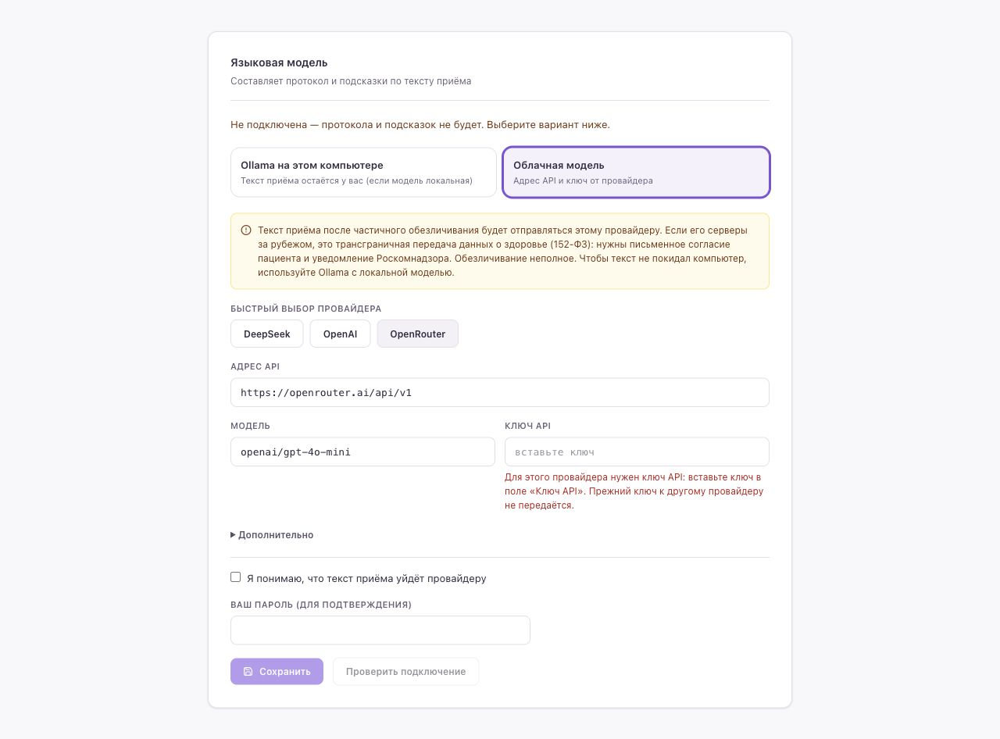

# Подключить ИИ для протокола

[← Установка](START.md)

Распознавание речи устанавливается вместе с MedScribe. Для превращения текста в протокол нужно отдельно подключить языковую модель. Выберите один способ:

| Способ | Что понадобится | Куда отправляется текст |
|---|---|---|
| Внешний сервис | Аккаунт провайдера, ключ API, доступный баланс | Провайдеру после частичного обезличивания |
| На своём компьютере | Ollama, скачанная локальная модель, дополнительная память | На ваш компьютер при локальной модели и локальном адресе |

Для первого теста используйте только [вымышленный пример](FIRST_PROTOCOL.md). Перед настоящими приёмами прочитайте [раздел о передаче данных](GUIDE.md#1-что-это-и-чем-не-является).

## Внешний сервис

1. Откройте кабинет выбранного провайдера, например [OpenRouter](https://openrouter.ai/settings/keys). Создайте ключ API в разделе ключей. Проверьте доступность API и баланс в кабинете провайдера. Ключ — секрет; храните его как пароль.
2. В MedScribe нажмите **«Профиль → Настройки ИИ»**. Выберите **«Облачная модель»**, затем кнопку нужного провайдера, например **OpenRouter**. Адрес и модель подставятся автоматически; для этого примера не редактируйте их вручную.
3. Вставьте ключ в **«Ключ API»**. Прочитайте предупреждение о передаче текста. Если этот способ вам подходит, отметьте **«Я понимаю, что текст приёма уйдёт провайдеру»**.
4. В поле **«Ваш пароль»** введите пароль от MedScribe и нажмите **«Сохранить»**. Это пароль программы, а не провайдера.
5. Нажмите **«Проверить подключение»**. **Ожидаемый результат:** «Работает, ответ за … мс». После этого выполните [пробную запись](FIRST_PROTOCOL.md).



**Важно по 152-ФЗ.** Текст приёма уходит провайдеру после частичного обезличивания; оно неполное, и сведения о здоровье могут остаться в тексте. Если серверы провайдера за границей (OpenRouter и подобные), это трансграничная передача данных о здоровье: нужны письменное согласие пациента и уведомление Роскомнадзора. Для настоящих приёмов используйте локальную модель (Ollama) или провайдера с серверами в России. Для пробной записи берите только вымышленный пример.

Если ключ не принят — проверьте, что он принадлежит выбранному сервису. Если не хватает средств или модель недоступна — проверьте кабинет провайдера. [Документация OpenRouter](https://openrouter.ai/docs/quickstart) и [страница модели из пресета](https://openrouter.ai/openai/gpt-4o-mini). Покупать подписку на чат-бот вместо доступа к API не нужно. Не переустанавливайте MedScribe из-за ошибки ключа.

Набор моделей и условия провайдеров меняются. Этот пример описывает заполнение формы; реальное подключение подтверждается только вашей проверкой и полученным пробным протоколом.

## На своём компьютере

Для локального варианта сначала прочитайте требования в [разделе 4.4 полной инструкции](GUIDE.md#44-подключение-локальной-модели-ollama): памяти должно хватать одновременно MedScribe и языковой модели. Установка MedScribe на компьютере с 16 ГБ не означает, что большая локальная модель на нём поместится.

1. Установите и запустите [Ollama](https://ollama.com/download).
2. Для первой попытки на компьютере с 16 ГБ памяти начните с **qwen2.5:7b** (около 4,7 ГБ). В терминале или PowerShell выполните:

   ```sh
   ollama pull qwen2.5:7b
   ```

   **Ожидаемый результат:** загрузка закончилась успешно. Это дополнительная загрузка сверх распознавания речи. На нашем стенде эта модель работает, но иногда путает, кто говорит: врач или пациент. Если памяти хватает, лучше по-русски работает **T-lite** (`hf.co/t-tech/T-lite-it-2.1-GGUF:Q8_0`, около 8,7 ГБ). Это не подтверждение медицинского качества или скорости на вашем компьютере.
3. В настройках приложения Ollama выставьте длину контекста **16384** или больше. [Официальная инструкция с изображением настройки](https://docs.ollama.com/context-length). Это увеличивает расход памяти. Если графической настройки нет, используйте способ для своей ОС из полной инструкции. Для Linux там же описано подключение Ollama из Docker.
4. В MedScribe откройте **«Профиль → Настройки ИИ → Ollama на этом компьютере»**. Нажмите **«Найти ещё раз»**, если приложение запустили только что. Выберите скачанную модель (например, **qwen2.5:7b**) из найденных. Не выбирайте вариант с пометкой `cloud`, если хотите локальную работу.
5. Введите пароль от MedScribe, нажмите **«Сохранить»**, затем **«Проверить подключение»**. Дождитесь ответа; первая загрузка модели может быть долгой. Затем выполните [пробную запись](FIRST_PROTOCOL.md).

Если Ollama не найдена, сначала убедитесь, что она запущена. Если не помогло — [полная инструкция](GUIDE.md#44-подключение-локальной-модели-ollama) или [сообщение о проблеме](HELP.md). Не вводите случайные адреса и названия моделей.
