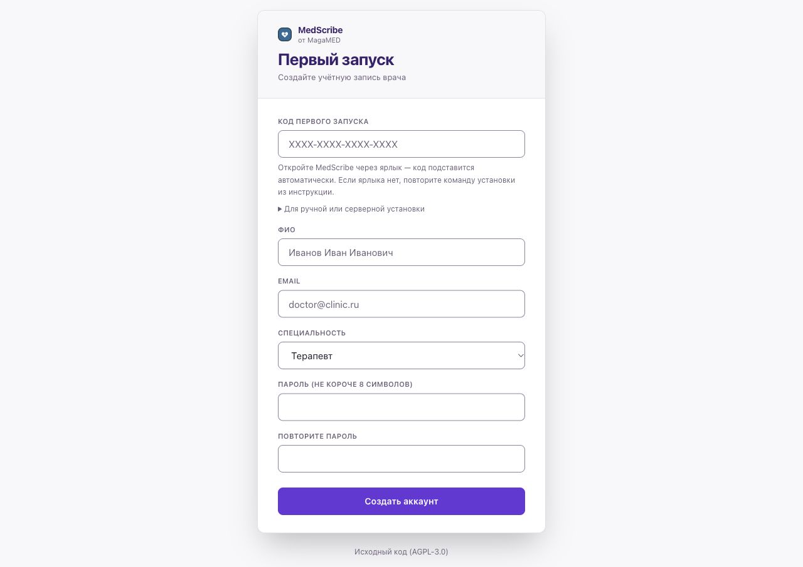

# Если установка или первый запуск остановились

[← Установка](START.md)

| Что произошло | Что сделать |
|---|---|
| Docker не найден | Установите Docker по инструкции своей системы, откройте его и повторите команду MedScribe |
| Docker не запустился | Откройте Docker Desktop, прочитайте его сообщение и дождитесь готовности. После этого повторите установку или откройте ярлык |
| Мало памяти | На Mac: Docker → Settings → Resources → Memory, не меньше 8 ГБ. Для Windows используйте раздел «Память для Docker» в [полной инструкции](GUIDE.md#2-что-понадобится) |
| Мало места | Освободите место на диске программы. Если хранилище Docker находится на другом диске, проверьте и его. Не удаляйте тома MedScribe в Docker: там ваши данные |
| Загрузка оборвалась / закрыли терминал | Откройте Docker и повторите ту же команду установки. Уже сохранённые данные останутся. Прерванный файл может скачаться заново |
| Браузер не открылся | Откройте ярлык MedScribe или ссылку из окна установщика |
| Просят код первого запуска / ссылка устарела | Закройте вкладку и откройте ярлык. Если ярлыка нет — повторите команду установки. Код и ссылку с ним не публикуйте |
| Распознавание ещё не готово | Оставьте Docker запущенным и компьютер включённым. Посмотрите этап загрузки в окне установщика. Плашка сама по себе не отличает загрузку от сбоя; если установщик сообщает ошибку, сохраните её текст |
| Микрофон не слышит | Разрешите микрофон в настройках сайта браузера и выберите нужное устройство в настройках системы. На своём компьютере открывайте адрес `localhost` |
| Собеседника не слышно в расшифровке | При очном приёме с петличками или внешним микрофоном проверьте по разделу [Внешние и беспроводные микрофоны](GUIDE.md#внешние-и-беспроводные-микрофоны). Пришлите строку настроек из «Проверить микрофон» и строки `[Mic]` из консоли браузера (F12) |
| Стенограмма есть, протокола нет | «Профиль → Настройки ИИ → Проверить подключение». Исправьте указанную ошибку и повторите формирование протокола |



## Сообщить о проблеме

Откройте [форму сообщения об ошибке](https://github.com/Allmostkill/medscribe/issues/new?template=bug_report.md). Для отправки нужен аккаунт GitHub. Укажите систему, шаг инструкции, что нажали и точный текст ошибки. Не отправляйте ключ API, пароль, ссылку с кодом регистрации или данные пациента.

Если программа уже установлена, можно приложить короткую диагностику. Она содержит версию, состояние Docker и служб. Она **не содержит журналов, записей приёмов, ключей или паролей** и не отправляется автоматически.

**macOS / Linux:** откройте терминал и выполните:

```sh
sh "$HOME/medscribe/scripts/diagnose.sh"
```

**Windows:** откройте Windows PowerShell и выполните:

```powershell
powershell -NoProfile -ExecutionPolicy Bypass -File "$env:USERPROFILE\medscribe\scripts\diagnose.ps1"
```

Параметр в команде Windows действует только для этого запуска PowerShell, не меняет постоянную политику системы. Если запуск запрещён политиками организации, приложите только текст исходной ошибки.

Команда покажет путь к файлу `medscribe-diagnostic…` в папке программы. Откройте его обычным текстовым редактором, проверьте содержимое и приложите к сообщению. Не прикладывайте `.env`, папку `secrets` или полный вывод `docker compose logs`.

Если файла `diagnose` нет, у вас прежний релиз или установка не дошла до распаковки. Диагностика необязательна: сообщите шаг и текст ошибки. При нестандартной папке установки укажите её путь вместо `medscribe`.

[Подробный справочник ошибок →](GUIDE.md#9-если-что-то-не-работает)
