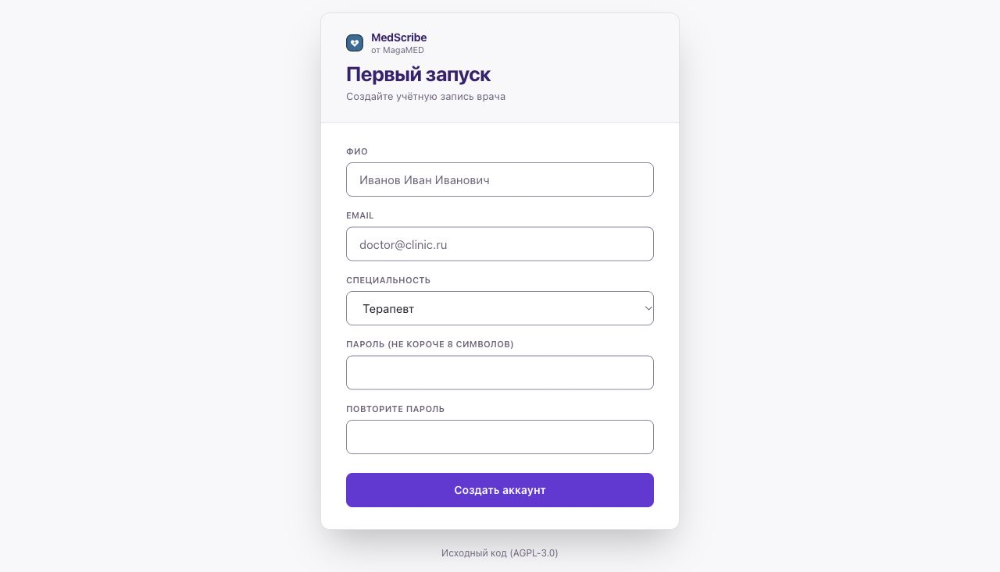

# Установка на macOS

[← Выбор системы](../START.md)

Перед началом: от 16 ГБ памяти, 4 ядра и 15 ГБ свободного места. Для протокола понадобится ключ внешнего ИИ или отдельно установленная локальная модель. [Подробные требования](../START.md).

## 1. Запустите Docker Desktop

В меню Apple откройте **«Об этом Mac»**: посмотрите объём памяти и тип процессора. На [официальной странице Docker для Mac](https://docs.docker.com/desktop/setup/install/mac-install/) выберите Apple silicon для процессора Apple M… или Intel для Intel.

Откройте скачанный `Docker.dmg`, перетащите Docker в «Программы» и запустите его оттуда. Следуйте подсказкам приложения. **Ожидаемый результат:** Docker сообщает, что движок запущен (Engine running).

В Docker откройте **Settings → Resources → Memory**, выделите не меньше 8 ГБ и примените изменения. Если пункты отличаются в вашей версии, используйте ссылку на официальную инструкцию выше.

## 2. Установите MedScribe

Нажмите **Cmd + Пробел**, напечатайте **Терминал** и откройте его. Скопируйте строку ниже, вставьте сочетанием **Cmd + V** и нажмите Enter:

```sh
curl -fsSL https://raw.githubusercontent.com/Allmostkill/medscribe/main/scripts/install.sh | sh
```

**Ожидаемый результат:** появляются шесть шагов установки, затем открывается браузер. В конце установки Finder покажет приложение MedScribe — перетащите его в Dock, если хотите запускать одним нажатием.

Если установка остановилась, исправьте причину из последнего сообщения и выполните ту же строку ещё раз. Не удаляйте данные программы в Docker. [Помощь по ошибкам →](../HELP.md)

## 3. Создайте аккаунт

В браузере заполните ФИО, email, специальность и дважды пароль. Нажмите **«Создать аккаунт»**. **Ожидаемый результат:** экран «Начало приёма».



Если код первого запуска не подставился или устарел, закройте вкладку. В Finder выберите **«Переход → Перейти к папке»**, вставьте `~/Applications` и откройте **MedScribe.app**. Ярлык получит актуальную ссылку.

## 4. Подключите ИИ и сделайте пробную запись

Жёлтая плашка о распознавании означает, что служба ещё не готова. Пока идёт загрузка, [подключите ИИ](../CONNECT_AI.md). После готовности распознавания сделайте [первую пробную запись](../FIRST_PROTOCOL.md).

**Завтра:** откройте MedScribe из Dock или найдите через Spotlight. Ярлык при необходимости запустит Docker. Устанавливать программу заново не нужно.
