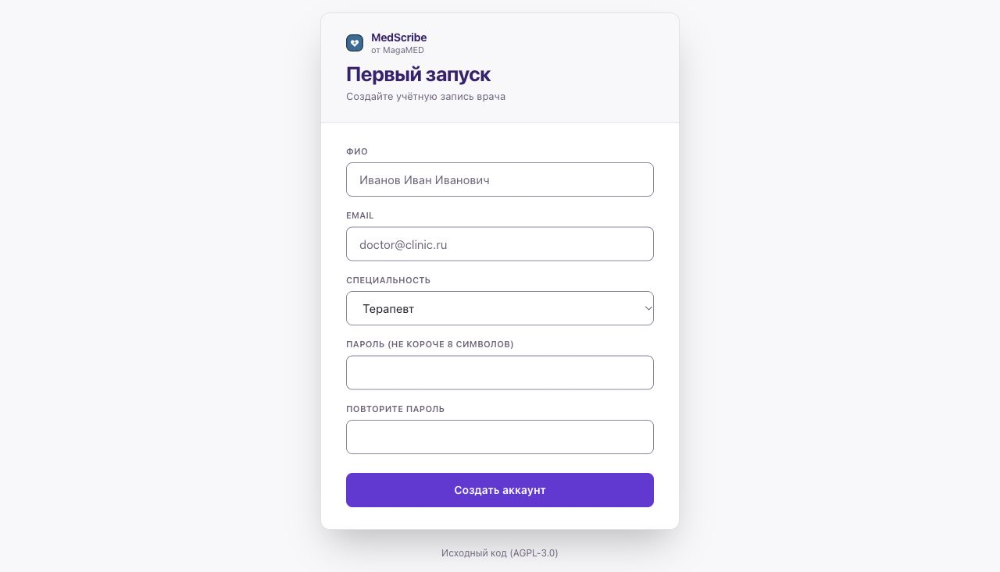

# Установка на Windows

[← Выбор системы](../START.md)

Перед началом: от 16 ГБ памяти, 4 ядра и 15 ГБ свободного места. Для протокола понадобится ключ внешнего ИИ или отдельно установленная локальная модель. [Подробные требования](../START.md).

## 1. Запустите Docker Desktop

Откройте [официальную страницу Docker для Windows](https://docs.docker.com/desktop/setup/install/windows-install/), проверьте требования к вашей версии Windows и скачайте установщик. Запустите его и следуйте подсказкам. Если установщик просит перезагрузку — перезагрузите компьютер.

Откройте Docker Desktop через меню «Пуск». **Ожидаемый результат:** приложение сообщает, что движок запущен (Engine running). Одного значка кита недостаточно — запуск может ещё идти.

Если Docker просит обновить WSL, выполните его инструкцию и снова откройте Docker. Если компьютер организации запрещает установку — не меняйте политики безопасности; [сообщите о препятствии](../HELP.md).

## 2. Установите MedScribe

Откройте «Пуск», напечатайте **Windows PowerShell** и откройте программу. Для команды MedScribe запуск от администратора не нужен. Скопируйте всю строку, вставьте в PowerShell и нажмите Enter:

```powershell
[Net.ServicePointManager]::SecurityProtocol='Tls12'; iex ((irm https://raw.githubusercontent.com/Allmostkill/medscribe/main/scripts/install.ps1).TrimStart([char]0xFEFF))
```

**Ожидаемый результат:** появляются шесть шагов установки. Затем открывается браузер и на рабочем столе появляется ярлык MedScribe. Не вставляйте команду повторно, пока текущая установка работает.

Если установка остановилась, прочитайте последнее сообщение. Исправьте указанную причину и выполните ту же команду ещё раз. Не удаляйте папку программы или её данные в Docker. [Помощь по ошибкам →](../HELP.md)

## 3. Создайте аккаунт

В открывшемся браузере заполните ФИО, email, специальность и дважды пароль. Нажмите **«Создать аккаунт»**. Код первого запуска обычно подставляется автоматически.

**Ожидаемый результат:** экран «Начало приёма». Если страница просит код или говорит, что он устарел, закройте её и откройте MedScribe через ярлык на рабочем столе.



## 4. Подключите ИИ и сделайте пробную запись

Распознавание речи может ещё загружаться: в программе будет жёлтая плашка. Пока ждёте, [подключите ИИ](../CONNECT_AI.md). После готовности распознавания сделайте [первую пробную запись](../FIRST_PROTOCOL.md).

**Завтра:** дважды нажмите ярлык MedScribe на рабочем столе. Повторять установку каждый день не нужно.
